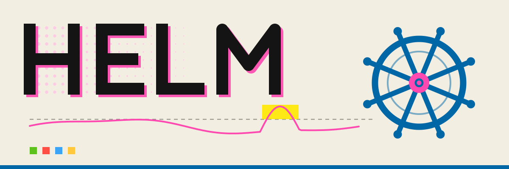
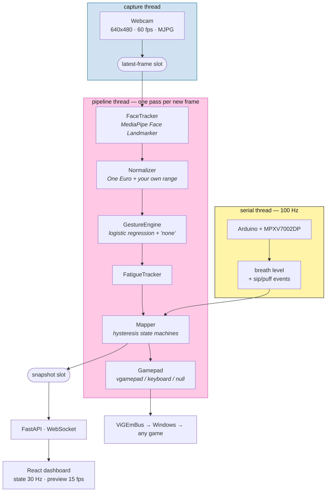
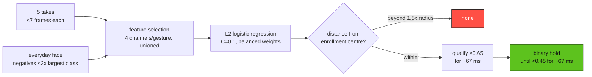
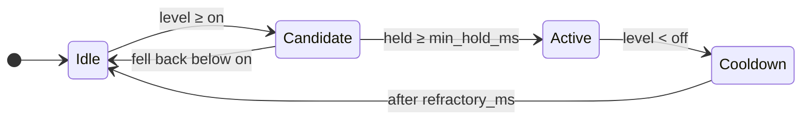
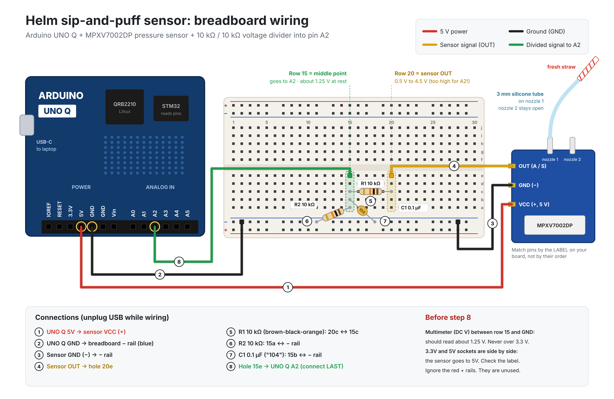
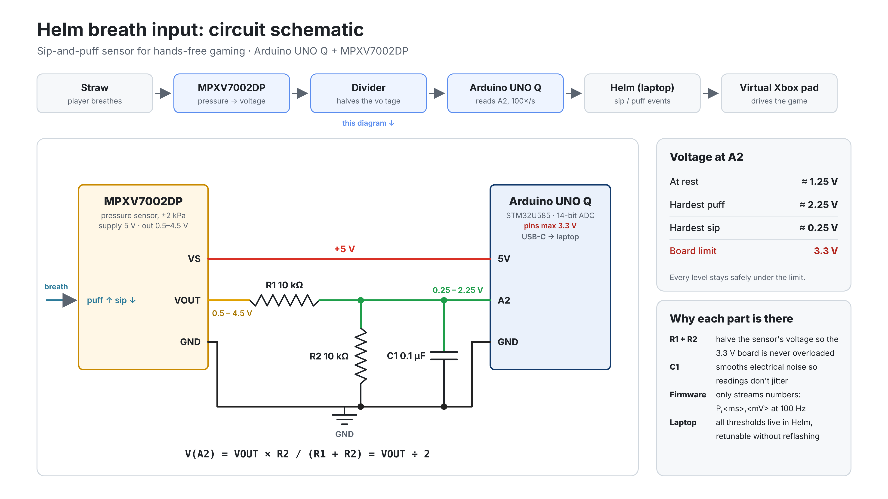
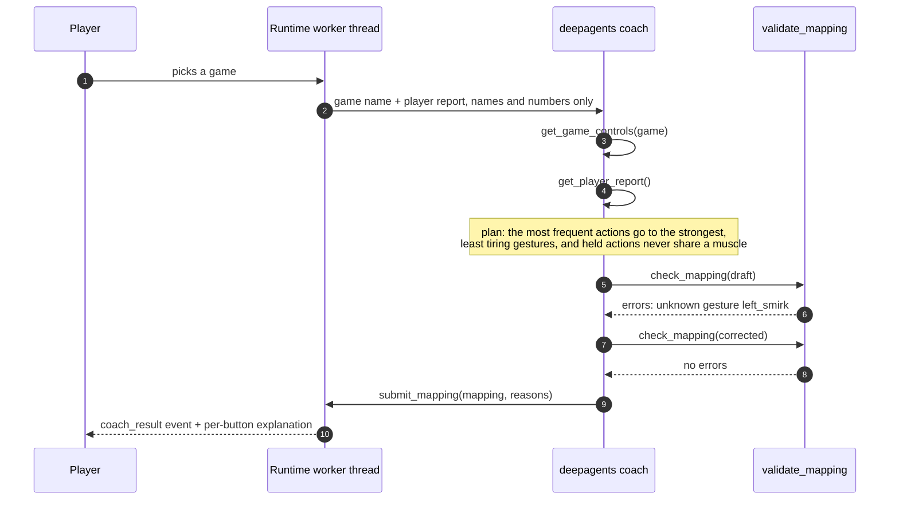

<!-- OWNER: P4 -->
<div align="center">

<picture>
  <source media="(prefers-color-scheme: dark)" srcset="docs/img/banner-dark.svg">
  <source media="(prefers-color-scheme: light)" srcset="docs/img/banner-light.svg">
  
</picture>

### A game controller you steer with your face. Play with whatever moves.

**Helm turns any webcam into a real Xbox 360 controller — your head is the stick, your face is the buttons, a straw is the throttle — and it measures *your* range instead of asking you to reach someone else's.**

<br>


<br>

[](#try-it-in-60-seconds)
[](#how-it-works)
[](#3--breathing--the-sip-and-puff-circuit)
[](#what-we-actually-measured)

<br>

**Built at HackPrinceton Fall '26** · four people · 36 hours · one Python process

</div>

---

> [!NOTE]
> **Status: working, still being measured.** Capture, face tracking, calibration, learned gestures,
> face identity, mapping, the virtual pad, breath input, the coach agent and the dashboard all run
> today. The evaluation is partly done: the numbers below are marked either **measured** or
> **not yet measured**, and we don't publish one that wasn't.

The profile picker also offers [two-player mode](docs/MULTIPLAYER.md): recognize two
enrolled profiles in one camera and assign each to an independent controller.

<br>

## The problem

Every adaptive controller on the market still assumes you can press something.

| Existing approach | What it still demands |
|---|---|
| Switch hubs (incl. the Xbox Adaptive Controller) | a body part that can reliably push a switch |
| Mouth joysticks and sip-and-puff rigs | a lip seal, neck control, and enough breath |
| Face-tracking mouse tools | fixed thresholds tuned for *pointing*, not for steering |
| Eye tracking | your eyes — the one thing a player needs free |

Many people with limited hand and arm movement can still turn their head a little and move part of
their face, sometimes only on one side. Helm starts from whatever movement a person actually has.

The design consequence runs through the whole codebase: **nothing in Helm has a universal
threshold.** Every number a gesture is judged against is derived from that specific player's own
calibration, and keeps adapting while they play.

<br>

## What it actually does

<table>
<tr><td width="33%" valign="top">

**🧭 Head = analog stick**

A 45-second calibration measures how far you can comfortably turn. A 12° head turn can mean full
lock, if 12° is your limit.

</td><td width="33%" valign="top">

**😀 Face = buttons + triggers**

52 expression channels, hysteresis, minimum hold and a refractory period. A half-open jaw is half
throttle.

</td><td width="33%" valign="top">

**🫁 Breath = one more axis**

A straw on a differential pressure sensor. Hard puff latches the throttle, sip is an analog brake.

</td></tr>
<tr><td valign="top">

**🧠 It learns *your* move**

Show Helm any movement five times, then talk and look around for 15 s so it learns what **not** to
fire on. A one-sided smile works as well as any other.

</td><td valign="top">

**🤖 An agent writes the mapping**

A `deepagents` loop reads the game's controls and your reliable gestures, drafts a mapping, checks
it against the validator, fixes its own errors, and submits.

</td><td valign="top">

**📉 It adapts as you tire**

If a gesture weakens over a session, Helm lowers that gesture's threshold — and tells you it did.

</td></tr>
</table>

Helm appears to Windows as a **real Xbox 360 pad**, so it works with any game that accepts one, with
no mods and no per-game integration. Closing your eyes for one second pauses it.

> [!IMPORTANT]
> **Everything runs on the laptop.** Video never leaves the machine and is written to disk only when
> `--dev` is passed explicitly. During ordinary play only numbers — head angles and expression
> scores — move between modules. The coach agent sees a game name, gesture names and numbers; it
> never sees an image.

<br>

## Try it in 60 seconds

No camera, no gamepad, no Arduino needed — this runs on any laptop:

```bash
pip install -r requirements.txt
python -m helm --mock --output null        # then open http://localhost:8000
```

With a real webcam:

```bash
cd ui && npm install && npm run build && cd ..
python -m helm                             # auto-picks the gamepad backend
python -m helm --player sam --game SuperTuxKart
```

<details>
<summary><b>Every flag</b></summary>

<br>

| Flag | What it does |
|---|---|
| `--mock` | synthetic face data instead of a camera (serves a cartoon face as the preview) |
| `--replay PATH` | replay a recorded `.npz` instead of the camera |
| `--record PATH` | save `FrameFeatures` while running — numbers only, never pixels |
| `--output auto\|vgamepad\|keyboard\|null` | gamepad backend; `auto` picks vgamepad on Windows |
| `--player NAME` | load/save that player's profile. `guest` and `judge` never persist a calibration |
| `--game NAME` | `SuperTuxKart`, `Celeste` or `Minecraft` (see `helm/games.json`) |
| `--serial PORT\|auto\|off` | breath sensor port. `auto` matches by USB vendor ID |
| `--camera N` · `--port N` | camera index, dashboard port |
| `--no-server` · `--seconds N` | headless pipeline, stop after N seconds (used by the smoke test) |
| `--dev` · `--dev-dir` | **opt-in** video + signal recording for debugging |

</details>

<br>

## How it works

One Python process. Four threads. Stages hand off through **latest-value slots, never queues** — a
slow consumer drops a stale frame instead of building a lag debt you can feel in a kart.



Vision and control deliberately share one thread: **control only has new information when a new
frame has been processed**, so splitting them would buy nothing but a race.

Every frame carries three timestamps, so latency is *measured*, never estimated:

$$\text{vision} = t_{\text{infer}} - t_{\text{capture}} \qquad \text{control} = t_{\text{output}} - t_{\text{infer}} \qquad \text{total} = t_{\text{output}} - t_{\text{capture}}$$

<br>

### 1 · Seeing — the vision pipeline

MediaPipe's Face Landmarker gives us, per frame: **478 landmarks**, a **4×4 facial transformation
matrix**, and **52 blendshape scores** (`jawOpen`, `mouthSmileLeft`, `browInnerUp`, …).

Head pose comes out of the transform matrix, but not naively — the matrix block carries scale and
noise, so it's re-orthonormalised through an SVD before the Euler extraction, with a determinant
check so a reflected solution can't flip a sign mid-race:

```python
u, _, vt = np.linalg.svd(r)          # re-orthonormalize: the block carries scale and noise
r = u @ vt
if np.linalg.det(r) < 0:             # a reflection would silently invert steering
    u[:, -1] *= -1
    r = u @ vt
yaw, pitch, roll = Rotation.from_matrix(r).as_euler("yxz", degrees=True)
```

Then the **Normalizer** removes *your* neutral and divides by *your* range, per axis and per
direction (your left reach and right reach are measured separately):

$$a_{\text{axis}} = \operatorname{clamp}\left(\frac{\theta - \theta_{\text{neutral}}}{r_{\pm}}, -1, 1\right) \qquad\qquad e_i = \frac{b_i - n_i}{p_i - n_i}$$

Smoothing is a **One Euro filter** — a low-pass whose cutoff rises with speed, so it kills jitter
at rest without adding lag when you turn:

$$f_c = f_{c_{\min}} + \beta \lvert \dot{x} \rvert$$

> [!TIP]
> **The single most expensive lesson in this repo.** The One Euro paper's $\beta = 0.01$ is for
> *pixel* units. On normalized $[-1, 1]$ axes that same value lagged a head turn by **~270 ms** —
> unplayable. Helm runs $\beta = 1.0$ and lets the dead zone absorb the jitter instead.

<details>
<summary><b>Three more traps that each cost us an hour</b></summary>

<br>

- **Never mirror the frame before inference.** MediaPipe's `...Left`/`...Right` scores refer to the
  *subject's own* face. Mirroring the image for display before tracking silently swaps every
  left/right expression. Helm mirrors only the preview, and its landmarks.
- **`detect_for_video` needs strictly increasing integer millisecond timestamps.** Not float
  seconds. Not merely non-decreasing.
- **Blendshape index 0 is `_neutral`.** Index-based access is off by one forever. Helm looks
  everything up by name from `contracts.BLENDSHAPE_NAMES`, and verifies that tuple against the
  model's own category names at startup rather than trusting it.

</details>

<br>

### 2 · Deciding — calibration, the classifier, and the triggers

**Calibration** is a state machine with no clicks — steps advance on what you actually did, not on a
timer alone. A head-range step waits until your head has been more than 6° from neutral *for 1.5
seconds*, then gives up at 8 s and uses what it measured.

> That "wait for the move" rule is itself a bug fix. Fixed 2.5 s steps were ending **before the
> player turned** — the spoken prompt alone takes about 3 seconds — so ranges were measured tiny,
> hit the floor, and a 2° twitch became full lock. Timing a prompt against a human is a measurement
> problem, not a UI detail.

Expressions aren't trusted just because MediaPipe reports them. Each one must produce **≥2 clean
repetitions**, each reaching a sensible fraction of the median peak, and must clear how much your
*relaxed* face already moves (the 98th percentile over the neutral and head-turn steps). Anything
that fails is marked unreliable and the coach will not map it.

**Learned gestures** are where the personalization gets real. Five takes of your move, then 15
seconds of talking and looking around as explicit negatives:



Three details that matter more than the model choice:

- **The `none` class is explicit, not implied.** Speech moves the same muscles as a deliberate
  gesture, so every player records negatives, and a model refuses to arm without them.
- **Only the 51 facial movement channels are candidates.** `_neutral`, the head axes and breath are
  structurally barred from becoming classifier features — otherwise a gesture learns to mean
  "while steering left."
- **Learned output is a binary qualified command, not analog intensity.** That's also what stops
  fatigue scaling from quietly sliding past the confidence gate.

Finally every control — learned or not — passes through a **hysteresis `Trigger`**:



Separate `on`/`off` thresholds (0.6 / 0.4) stop a level hovering at the line from machine-gunning
the button; `min_hold_ms` rejects a talking twitch; `refractory_ms` rate-limits. Modes are
`tap`, `hold` and `toggle`.

> [!WARNING]
> **Breath needed its own rule.** A sip/puff event is level `1.0` for exactly one tick, so the
> 60 ms minimum hold that protects expression buttons would have blocked *every single breath
> command*. Breath gestures run `min_hold_ms = 0`. A correct safety rule applied to the wrong input
> is indistinguishable from a dead sensor.

<br>

### 3 · Breathing — the sip-and-puff circuit

An **MPXV7002DP** differential pressure sensor on a straw. The firmware is deliberately dumb: it
streams raw readings and **every threshold lives on the laptop**, per player.

```
   ┌─────────────────┐
   │   MPXV7002DP    │                        Arduino UNO Q
   │  ±2 kPa diff.   │
   │                 │
   │  VCC ●──────────┼────────────────────────────● 5V
   │  GND ●──────────┼────────────────────────────● GND
   │  OUT ●──────────┼──[ R1 10kΩ ]──┬────────────● A2
   │                 │               │
   │  ○ port A  ○ port B             │         ⚠ 3.3 V pin — never direct
   └──┬──────────────┘          [ R2 10kΩ ]
      │ 3 mm silicone tube           │  ╷╷ 0.1 µF (optional)
      │  (port B open to air)        ├──╵╵──┐
   ┌──┴────┐                         │      │
   │ straw │ ← fresh one per person  └──────┴───● GND
   └───────┘
```

The divider exists because the sensor swings to 4.5 V and a UNO Q pin tops out at 3.3 V:

$$V_{A2} = V_{\text{out}} \cdot \frac{R_2}{R_1 + R_2} = \frac{V_{\text{out}}}{2} \qquad\Rightarrow\qquad 0.5 \text{ to } 4.5 \text{ V} \quad\longrightarrow\quad 0.25 \text{ to } 2.25 \text{ V}$$

…and the sketch multiplies by 2 on the way out, so **the laptop sees the sensor's real millivolts
and does not care which board is attached**:

```
P,<millis>,<millivolts>          ~2500 mV at rest · up on a puff · down on a sip
```

Real diagrams, not redrawn ones — these are the files the build was made from:

<p align="center">
  
  
</p>

<details>
<summary><b>Four UNO Q traps, each of which fails silently</b></summary>

<br>

| Trap | What happens | Why |
|---|---|---|
| Printing with `Serial` | laptop sees **nothing**, board looks dead | On the UNO Q, `Serial` is the UART on pins 0/1 and never reaches USB-C. You must print through `Monitor` (`Arduino_RouterBridge.h`) — the USB port belongs to the Linux side. |
| Calling `pinMode()` on the sensor pin | `analogRead` sticks at **~270** forever | Breaks the analog path on this board. Just don't call it. |
| Using A0 or A1 | works, then degrades | They are the pins that are **not** 5 V tolerant. Use **A2**. |
| Opening the port on Windows with the IDE's Serial Monitor open | `breath_connected` stays false, the card never appears, **no error** | Windows gives one process exclusive ownership of a COM port. |

Also: the Linux side takes 30–60 s to boot before the port enumerates, and it **queues serial lines
while the port is closed** — so on connect it dumps a backlog at ~1500 lines/s. `SipPuff._drain_backlog`
tells live data from backlog by inter-line wait time, which is why breath is intentionally dead for
the first ~15–20 s after Helm starts.

</details>

<details>
<summary><b>Why the breath scales are asymmetric (a measurement story)</b></summary>

<br>

We shipped `BREATH_MAX_*_MV = 400.0` as a placeholder. Then we actually instrumented the rig, and
the placeholder turned out to be **~6× too small** — the opposite of what the noise data predicted:

```
baseline       2382 mV      rest noise 40 mV peak-to-peak      2 mV ADC step
hard sip       displacement  2360 / 2360 / 1766 mV             ← repeatable
hard puff      displacement  2410 / 1024 / 1078 mV             ← not repeatable
```

With 400 mV as full scale, the analog sip-brake had **no travel**: a gentle sip would have slammed
it fully on. No unit test could have caught it, because the fake serial port agreed with the wrong
number.

So the shipped scales are deliberately asymmetric — `MAX_SIP = 1800`, `MAX_PUFF = 1000`. Puff is
scaled near the *low* end of its spread, because if it were scaled to its best value an ordinary
puff would never clear the hard-puff threshold and the latched throttle would silently stop working
mid-demo. And because strangers' lungs aren't ours, `BreathCalibrator` re-measures both directions
per player in two prompted breaths — and **refuses** a measurement under 200 mV rather than saving a
number that only looks calibrated.

</details>

<br>

### 4 · Mapping — the coach agent

Turning "this player, this game" into a working mapping is the genuinely agentic part. It's a
`deepagents` loop with four real tools and a hard validator gate — **not one LLM call**:



`submit_mapping` is **only accepted when `check_mapping` returned no errors** — the agent cannot
talk its way past the schema. And the whole thing is optional by construction:

> [!NOTE]
> **The demo never depends on Wi-Fi.** With no API key, no network, a failure, or a 60 s timeout,
> the coach falls back to the cached default mapping in `profiles/_defaults/<game>.json`, filtered
> to the gestures that were reliable for *this* player, with the rationale `"offline default"`.
> It runs on a worker thread and never touches the pipeline.

A mapping is plain JSON you can hand-edit — files are watched and reloaded live, once a second:

```jsonc
{
  "axes": [{"source": "yaw", "target": "lx", "deadzone": 0.08, "curve": 1.5}],
  "gestures": {
    "brow_raise":  {"kind": "blendshape", "sources": ["browInnerUp"], "on": 0.6, "off": 0.4, "min_hold_ms": 100},
    "smile":       {"kind": "blendshape", "sources": ["mouthSmileLeft", "mouthSmileRight"],
                    "combine": "max", "on": 0.6, "off": 0.4, "min_hold_ms": 100},
    "eyes_closed": {"kind": "blendshape", "sources": ["eyeBlinkLeft", "eyeBlinkRight"], "combine": "min",
                    "on": 0.85, "off": 0.6}
  },
  "buttons": [{"gesture": "brow_raise", "target": "A", "mode": "tap"}],
  "pause":   {"gesture": "eyes_closed", "hold_ms": 2000}
}
```

Note `"combine": "max"` on the smile — **either** side counts, which is the whole point for a player
whose face moves on one side only. And `"combine": "min"` on `eyes_closed`, so a wink can never
pause the game.

<br>

## Safety

A controller that fires by accident is worse than no controller. The pad is forced to **full
neutral** whenever any of these is true:

| Condition | Why |
|---|---|
| No face for 200 ms | you walked away, or tracking dropped |
| Calibration running | you're being asked to make faces on purpose |
| Breath calibration running | you're being asked to breathe hard on purpose |
| A gesture take is recording | same |
| Paused | eyes closed for 1 s, toggled |

Plus, in the pipeline loop: **any exception logs once, sends a neutral state, and keeps running.**
Helm is not allowed to crash out of a race.

<br>

## What we actually measured

> [!IMPORTANT]
> Numbers are marked **measured** or **not yet measured**, and nothing moves to the first column
> without a run behind it. No participant in any test had a motor impairment, and the
> restricted-range condition is a **proxy**, not a substitute.

| | Result | Status |
|---|---|---|
| Software latency, end to end | **~9.4 ms** total, ~9.0 ms of it vision (M-series Mac, fake camera serving a real face) | ✅ measured |
| Serial link quality | 2207 lines parsed, **0 unparseable**; 2 mV ADC step; 12–40 mV rest noise | ✅ measured |
| Breath range, real rig | rest 2382 mV; hard sip 2360 mV displacement; hard puff 1024–2410 mV | ✅ measured |
| Learned-gesture false fires | **5 false commands in 55.97 s** (5.36/min) on a frozen negative clip never used for fitting or tuning | ⚠️ measured, and *not good enough* |
| Research-profile parity after integration | scores match the three study profiles within **2.3 × 10⁻⁸** | ✅ measured |
| Test suite | **411 tests passing** | ✅ measured |
| Motion-to-screen latency vs. a real Xbox pad | 240 fps slow-motion, 20 trials per condition — `eval/latency.html` | ⏳ not yet measured |
| Restricted-range target test | `eval/target_test.html` | ⏳ not yet measured |
| **False triggers: fixed-threshold baseline vs. full Helm** | **3.0 vs 67.4 per minute** (median, n = 3, Windows laptop, 3 min each of reading aloud, chatting, watching video). 24 vs 520 false presses in 9 min, a **95% reduction**, 94–96% for every participant. Blink and eyebrow false presses: 265 and 191 on the baseline, **0** with Helm | ✅ measured |
| Learned move, recognized on unseen tries | **median 80%** (80 / 80 / 100%, leave-one-take-out, 5 takes each, n = 3); built-in nod 100% | ✅ measured |
| Tracking on the demo laptop | **29.8 fps**, face tracking **7.2 ms** median per frame (n = 3, 16,083 frames) | ✅ measured |

No participant had a motor impairment, and n = 3 is small: read the false-trigger result as a strong, consistent signal, not a clinical claim.

We're keeping the bad number visible on purpose. An earlier, much prettier result (28/30 attempts,
**zero** false events in 128.5 s) didn't generalize — it had reused recordings for feature
selection. The 5-in-56-seconds figure is what happened on a clip the model had never influenced,
and that is the number that counts.

<br>

## Setup

<details open>
<summary><b>Requirements</b></summary>

<br>

Python **3.11**, Node **18+**. Then:

```bash
pip install -r requirements.txt
cd ui && npm install && npm run build
```

</details>

<details>
<summary><b>Windows — the demo platform</b></summary>

<br>

The virtual Xbox pad needs the **ViGEmBus** driver, which the `vgamepad` installer offers to
install. Without it, Helm falls back to keyboard emulation automatically.

Camera: Helm opens with `cv2.CAP_DSHOW`, requests MJPG and sets buffer size 1 — anything else gives
you a laggy or 1 fps stream on Windows.

> [!TIP]
> Create the virtual pad **before** launching the game, and let Helm send its startup button tap,
> or the game may never notice the controller exists.

**Breath sensor on Windows:** the sketch is already flashed, so nothing needs reflashing. Plug in,
wait 30–60 s for the board to enumerate, then `--serial auto` finds it by USB vendor ID
(`0x2341`) — the macOS-only `usbmodem` name match isn't needed. Fallback is `--serial COM5`; list
ports with `python -m serial.tools.list_ports -v`. **Close the Arduino IDE's Serial Monitor first**
or Helm cannot open the port, and it will not tell you why.

</details>

<details>
<summary><b>macOS and Linux — development</b></summary>

<br>

Everything runs except the virtual controller (`vgamepad` is Windows-only). Use `--output null` or
`--output keyboard`. All hardware and OS access is imported lazily inside the class that needs it,
specifically so `--mock --output null` runs anywhere.

</details>

<details>
<summary><b>The coach agent (optional)</b></summary>

<br>

Set `HELM_COACH_MODEL` (a `provider:model` string, default `anthropic:claude-opus-5-5`) and that
provider's API key, in the environment or a gitignored `.env`. With neither, the coach uses its
offline path and the demo is unaffected.

</details>

<br>

## Repo map

```
helm/
  main.py          Runtime: threads, the pipeline loop, CLI          P1
  capture.py       camera thread, latest-frame slot                  P1
  vision.py        Face Landmarker wrapper → FrameFeatures           P1
  filters.py       One Euro, axis shaping, Normalizer, drift         P1
  calibration.py   Calibrator state machine (full and quick)         P1
  coach.py         deepagents coach: build mapping, review session    P1
  mock.py          mock source, record, replay                       P1
  output.py        gamepad backends: vgamepad, keyboard, null        P2
  mapping.py       Trigger state machine, Mapper → ControlState      P2
  profiles.py      load, save, validate calibration and mappings     P2
  sipnpuff.py      serial thread, breath level, sip/puff events      P2
  gestures.py      TakeRecorder, GestureModel, GestureEngine         P3
  adapt.py         FatigueTracker                                    P3
  identity.py      per-profile face enrollment (SFace)               P3
  server.py        FastAPI + WebSocket, preview encoding             P4
  contracts.py     dataclasses crossing every boundary — FROZEN      shared
  config.py        every tunable number, one section per lane        shared

firmware/sipnpuff/        classic Uno/Nano sketch + wiring diagrams
firmware/sipnpuff_unoq/   UNO Q sketch (Monitor, A2, divider)
ui/                       React + Vite + TypeScript dashboard
eval/                     latency, false-trigger and target-test tooling
profiles/<player>/        calibration.json · breath.json · gestures.npz · <Game>.json
```

<details>
<summary><b>How four people shipped this in 36 hours without merge hell</b></summary>

<br>

Trunk-based: everyone commits to `main`. 54 commits, four contributors, **zero merge commits** —
a strictly linear history, because ownership is enforced at file granularity, not by politeness:

- Every source file opens with `# OWNER: Pn`. You edit only your lane's files.
- Need a change in someone else's file? You don't write it. You hand them the exact request —
  file, function, signature, behavior — and they do it.
- `helm/contracts.py` is **frozen**. Every dataclass that crosses a boundary was agreed up front,
  so four people could build against interfaces that weren't moving. When breath calibration needed
  per-player persistence and `Calibration` had no field for it, the answer was a *separate*
  `breath.json` beside it — not an unfreeze.
- `helm/config.py` is sectioned by lane. Tunable numbers never live inline.
- Commits are prefixed with the lane: `P2: hysteresis and tap/hold/toggle modes`.
- Before every push: `git pull --rebase`, then the smoke run. Never push a `main` that fails it.

| Lane | Owns |
|---|---|
| **P1** Perception and runtime | `main.py` `capture.py` `vision.py` `mock.py` `filters.py` `calibration.py` `coach.py` `games.json` |
| **P2** Control and hardware | `output.py` `mapping.py` `profiles.py` `sipnpuff.py` `firmware/` `profiles/` |
| **P3** Learning and evaluation | `gestures.py` `adapt.py` `identity.py` `eval/` |
| **P4** Product and story | `server.py` `ui/` `README.md` |

</details>

<br>

## Tests

```bash
python -m pytest -q                                           # 411 tests
python -m helm --mock --output null --no-server --seconds 3   # smoke run, must exit 0
```

Everything with pure logic — filters, triggers, the classifier, profile validation, breath event
detection, the calibration state machines — is tested **without a camera, gamepad or serial port**.
That's not a style preference: it's what let four people run the full suite on three different
operating systems all weekend.

<br>

## Honest scope

Helm is a 36-hour hackathon build, and the parts are not equally finished.

**Solid:** the pipeline and its safety rules, calibration, hysteresis mapping, the virtual pad,
profiles, the breath sensor end to end, the coach's offline path, the dashboard.

**Real but young:** learned gestures work and are genuinely personal, but 5 false commands per
minute on held-out negatives is *not* good enough to call solved, and we'd rather show that number
than hide it. Face identity uses a conservative admission policy that still needs validating on
fresh recordings.

**Not done:** the motion-to-screen latency study, the restricted-range target test, and the
baseline-vs-Helm false-trigger comparison are specified, tooled and un-run.

**Never tested with the people it's for.** No participant so far has a motor impairment. Everything
above is a proxy, and the next real step isn't a feature — it's putting this in front of the people
it was built for and being told what's wrong with it.

<br>

---

<div align="center">

<picture>
  <source media="(prefers-color-scheme: dark)" srcset="docs/img/banner-dark.svg">
  
</picture>

**Built at HackPrinceton Fall '26.** MIT licensed.

*Play with whatever moves.*

</div>
